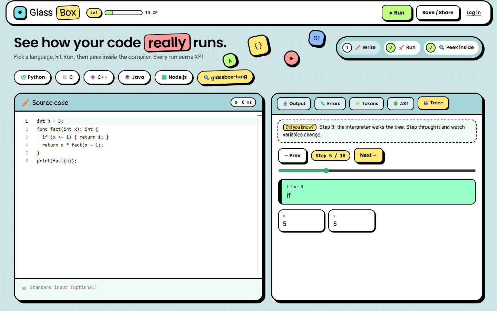

# GlassBox

GlassBox is a cloud compiler workspace for learning how programs execute. It
accepts Python, C, C++, Java, Node.js, and **glassbox-lang** programs, runs them in
resource-limited Docker sandboxes, and returns readable output and diagnostics.
The distinguishing feature is the glassbox-lang pipeline visualizer: every run
can expose positioned tokens, a recursive AST, and an interpreter trace with
source lines and variable scopes.



## Features

- Monaco source editor with language-aware syntax highlighting.
- Python, C, C++, Java, Node.js, and glassbox-lang execution.
- Output and Errors tabs with bounded execution time.
- glassbox-lang Tokens, AST, and Trace views.
- JWT signup/login and authenticated snippet save/share links.
- BullMQ/Redis queueing, Postgres job persistence, and Socket.IO-ready API.
- Docker sandbox limits: no network, read-only work directory, 128 MB RAM,
  0.5 CPU, 64 processes, and an eight-second worker timeout.
- Responsive two-pane editor that stacks on mobile.
- Playful learning interface inspired by FFCS-inator: pastel neo-brutalist
  styling, language chips, a Write → Run → Peek inside quest tracker, XP and
  levels per successful run, and a "Did you know?" tip on every result tab.

## Using the workspace

1. **Pick a language** from the chip row (Python, C, C++, Java, Node.js, or
   glassbox-lang). Switching loads a starter program for that language.
2. **Write** in the Monaco editor and optionally add standard input below it.
3. **Run** with the green button. The status pill shows `Running…`, then the
   execution time. A successful run awards 10 XP (a new level every 50 XP); a
   failed run switches to the Errors tab. XP is kept in the browser's
   `localStorage`, so it is per-browser and never sent to the server.
4. **Peek inside** a glassbox-lang run with the Tokens (colour-coded lexer
   output), AST (foldable tree), and Trace (step buttons plus a slider, with
   in-scope variables shown as cards) tabs.
5. **Save / Share** copies a `/snippet/<id>` link after you log in.

Animations are disabled automatically when the operating system requests
reduced motion.

## Architecture

```text
Browser (React + Monaco)
          |
       nginx :80
       /          \
 frontend      api :3000 ---- Postgres :5432
                   |
                Redis :6379
                   |
              worker + Docker socket
                   |
       isolated runtime containers
 Python | C | C++ | Java | Node | glassbox-lang
```

### Services and request flow

1. **frontend** is a Vite-built React single-page application served by nginx.
2. **nginx** provides the public port and proxies `/api` and `/socket.io` to the
   API while serving the frontend bundle for all other paths.
3. **api** validates submissions, applies a ten-submissions-per-minute limit,
   stores a queued job, and adds a BullMQ job to Redis. It runs migrations
   before listening.
4. **redis** stores BullMQ queue state.
5. **worker** consumes jobs and invokes a runtime image through the Docker
   socket. It writes results to Postgres and always cleans the shared job
   volume.
6. **compiler-core** is copied into the glassbox-lang runtime. It performs
   lexing, parsing, semantic checks, and interpretation.
7. **postgres** stores users, jobs, results, and snippets.

The Run click posts source and stdin to `/api/submit`. The returned job ID is
polled by the client through `/api/result/:jobId`; the worker runs the selected
image and updates that row. A failed compile or timeout is a normal failed
result, not a server crash.

## Tech stack

| Choice | Reason |
|---|---|
| React + Vite | Small, fast single-page editor shell |
| Monaco | Familiar code editing and keyboard accessibility |
| Express | Straightforward JSON API and health endpoint |
| BullMQ + Redis | Durable asynchronous execution queue |
| PostgreSQL | Relational persistence for jobs and accounts |
| Docker | Per-language isolation and repeatable toolchains |
| Python | Compact teaching compiler implementation |
| nginx | Static asset serving and one public entry point |

## glassbox-lang reference

### Grammar (EBNF/BNF notation)

```bnf
program       ::= { statement } ;
statement     ::= variable-declaration | assignment | if-statement
                | while-statement | function-declaration | return-statement
                | print-statement | expression ";" ;
variable-declaration ::= type identifier "=" expression ";" ;
assignment     ::= identifier "=" expression ";" ;
if-statement  ::= "if" "(" expression ")" block [ "else" block ] ;
while-statement ::= "while" "(" expression ")" block ;
function-declaration ::= "func" identifier "(" [ parameters ] ")" [ ":" type ] block ;
parameters    ::= parameter { "," parameter } ;
parameter     ::= type identifier ;
return-statement ::= "return" expression ";" ;
print-statement ::= "print" "(" expression ")" ";" ;
block         ::= "{" { statement } "}" ;
type          ::= "int" | "float" | "bool" | "string" ;
expression    ::= logical-or ;
logical-or    ::= logical-and { "||" logical-and } ;
logical-and   ::= equality { "&&" equality } ;
equality      ::= comparison { ("==" | "!=") comparison } ;
comparison    ::= term { ("<" | ">" | "<=" | ">=") term } ;
term          ::= factor { ("+" | "-") factor } ;
factor        ::= unary { ("*" | "/" | "%") unary } ;
unary         ::= ("!" | "-") unary | primary ;
primary       ::= integer | float | string | "true" | "false"
                | identifier [ "(" [ arguments ] ")" ] | "(" expression ")" ;
arguments     ::= expression { "," expression } ;
```

Types are `int`, `float`, `bool`, and `string`; functions may return a named
type or `void`. Operators, from highest to lowest precedence, are unary `!`
and `-`, multiplicative `* / %`, additive `+ -`, comparisons, equality, `&&`,
then `||`. `+` also concatenates strings. Statements include declarations,
assignment, conditionals, loops, functions, return, print, and expression
statements.

Examples:

```text
int n = 5;
func fact(int x): int {
  if (x <= 1) { return 1; }
  return x * fact(x - 1);
}
print(fact(n));
```

```text
string greeting = "hello";
if (true) { print(greeting + "!"); }
```

Diagnostics retain source lines, for example `Line 1: cannot assign bool to
int`, `Line 1: expected ;`, `undefined variable 'x'`, and
`undefined function 'foo'`.

### Compiler theory mapping

| Phase | Implementation |
|---|---|
| Lexical analysis | `compiler-core/lexer.py` uses a positioned regular-expression scanner |
| Parsing | `compiler-core/parser.py` is a hand-written recursive-descent parser with precedence levels |
| Semantic analysis | `compiler-core/semantic.py` checks declarations, types, scopes, and calls |
| Interpretation | `compiler-core/interpreter.py` tree-walks AST nodes using chained environments and records trace data |
| AST model | `compiler-core/ast_nodes.py` contains serializable dataclass-like nodes |

## Prerequisites

- Docker Desktop with Linux containers and Compose v2 (Windows users should
  enable the WSL2 backend), or Docker Engine + Compose.
- Git.
- At least 4 GB RAM allocated to Docker; 8 GB is more comfortable while
  building the Java, C, and C++ images.
- Ports `80` (HTTP), `5432` (Postgres), and `6379` (Redis) must be available.
  Only port 80 is published by default.

## Run locally

```sh
git clone https://github.com/vedikaagarwal28/glassbox.git
cd glassbox
cp .env.example .env
docker compose up --build
```

Open <http://localhost>. The checked-in `.env.example` contains safe local
development values and works without editing. To use another HTTP port, set
`HTTP_PORT=8080` in `.env` and open <http://localhost:8080>.

The equivalent single development command is `make dev`. On Windows, run it
from WSL2 or use the Compose command directly.

### Run services without Docker

- **compiler-core:** `python -m unittest discover -s compiler-core/tests -v`
- **api:** `cd api && npm install && npm start` with Postgres, Redis,
  `DATABASE_URL`, `REDIS_URL`, and `JWT_SECRET` set.
- **worker:** `cd workers && npm install && npm start` with the same database
  and Redis variables plus a Docker daemon/socket.
- **frontend:** `cd frontend && npm install && npm run dev`; set
  `VITE_API_URL` if the API is not behind the same origin.

Tests can be run with `make test` or the compiler-core command above. Docker
image builds are validated with `docker compose build`; the full local stack
is started with `docker compose up --build`.

## Environment variables

| Variable | Default | Description |
|---|---|---|
| `POSTGRES_PASSWORD` | `glassbox-local-password` | Postgres password; replace in deployments |
| `JWT_SECRET` | `glassbox-local-development-secret` | JWT signing secret; replace in deployments |
| `CORS_ORIGIN` | `http://localhost` | Allowed browser origin |
| `HTTP_PORT` | `80` | Host port for nginx |
| `DATABASE_URL` | Compose-generated | API/worker Postgres connection string |
| `REDIS_URL` | `redis://redis:6379` | API/worker Redis connection string |
| `PORT` | `3000` | Internal API port |
| `VITE_API_URL` | `/api` | Frontend API base when running outside nginx |

## API reference

All JSON endpoints are relative to `/api`.

### `POST /auth/signup`

Request: `{"email":"user@example.com","password":"password123"}`  
Response: `{"token":"<jwt>"}`

### `POST /auth/login`

Request is the same as signup. Response is a JWT, or `401` with
`{"error":"invalid credentials"}`.

### `POST /submit`

Request:
`{"language":"python","code":"print(1)","stdin":""}`  
Response: `{"jobId":"<uuid>"}`. Supported languages are `python`, `c`, `cpp`, `java`,
`node`, and `glassbox-lang`. Invalid input returns `400`.

### `GET /result/:jobId`

Response:

```json
{
  "status": "completed",
  "stdout": "1\n",
  "stderr": "",
  "exitCode": 0,
  "executionTimeMs": 12,
  "memoryKb": 0
}
```

`status` is `queued`, `completed`, or `failed`. A timeout has
`stderr: "execution timed out"`. glassbox-lang results additionally include
`tokens`, `ast`, and `trace`.

### `POST /snippets`

Requires `Authorization: Bearer <jwt>`. Request is
`{"language":"python","code":"print(1)","stdin":""}`. Response is
`201 {"id":"<uuid>","url":"/snippet/<uuid>"}`.

### `GET /snippets/:id`

Public response: `{"id":"<uuid>","language":"python","code":"print(1)","stdin":""}`.

### `GET /health`

Internal readiness response: `{"status":"ok"}`.

## Security model and limitations

Each submitted program runs with `--network=none`, a read-only `/work`, a
temporary executable `/tmp`, 128 MB memory, half a CPU, 64 PIDs, and an
eight-second worker-side timeout. Submission requests are rate limited to ten
per minute per API process. Passwords are bcrypt-hashed and snippets require a
JWT to create.

This is an educational deployment baseline, not a hostile multi-tenant
service. The worker needs access to the Docker socket, so a compromised worker
would have daemon-level access. Use a dedicated host, rotate secrets, add TLS,
put authentication/rate limiting at the edge, and use separate worker hosts for
untrusted public traffic. Jobs are processed serially because the shared
volume is deliberately race-free; use per-job Docker volumes for higher
throughput.

## Deployment guide (DigitalOcean or EC2)

1. Create an Ubuntu VM with at least 2 vCPU, 4 GB RAM, and a public DNS record.
2. Install Docker Engine and the Compose plugin, clone the repository, and
   copy `.env.example` to `.env`.
3. Set long random `POSTGRES_PASSWORD` and `JWT_SECRET` values and set
   `CORS_ORIGIN` to the HTTPS origin.
4. Open only SSH, HTTP, and HTTPS in the cloud firewall. Run
   `docker compose up --build -d`.
5. Point nginx/your load balancer at the VM. For direct Certbot management,
   stop the Compose nginx briefly, install `certbot`, run
   `sudo certbot certonly --standalone -d example.com`, then add a 443 nginx
   server block with the generated certificates and redirect port 80 to 443.
6. Update with `git pull && docker compose up --build -d`; Postgres data is in
   the named `postgres_data` volume. Back it up before upgrades.

For production, terminate TLS, use a managed Postgres/Redis where practical,
restrict Docker access, and configure log shipping and monitoring.

## Troubleshooting

- **Compose parser error:** connection strings in the original Compose file
  were unquoted flow-map values. They are now quoted and the file validates
  with `docker compose config`.
- **API starts before its dependencies:** Postgres and Redis now have
  healthchecks, and API/worker use healthy `depends_on` conditions.
- **Missing runtime images:** all runtime images are explicit Compose
  build targets and are built by `docker compose build`.
- **Runtime cannot find `main`:** a worker-local temporary path is invisible
  to the host Docker daemon. Jobs now use the named `job_data` volume mounted
  by both the worker and runtime container.
- **C/C++/Java build errors:** C is compiled with `gcc -x c` and C++ with
  `g++ -x c++ -std=c++17`, because the submitted file is named `main` without
  an extension; Java is copied to writable `/tmp/Main.java` before compilation
  because `/work` is read-only.
- **Timeout:** a program that runs longer than eight seconds returns a failed
  result with `execution timed out`; check `docker compose logs worker`.
- **Port 80 in use:** set `HTTP_PORT=8080` in `.env`, then open port 8080.
- **Windows bind/socket issues:** use Docker Desktop Linux containers and the
  WSL2 backend. Ensure the project directory and Docker socket are shared.
- **Permission denied from Docker:** check that the Docker daemon is running
  and that the current user can use its socket.
- **Stale frontend bundle:** rebuild with `docker compose build frontend` and
  recreate with `docker compose up -d frontend nginx`.

## Project structure

```text
glassbox/
├── api/                 Express API, migrations, auth, queue producer
├── compiler-core/       Lexer, parser, semantic checker, interpreter, tests
├── docker/runtimes/     Python, C, C++, Java, Node, glassbox-lang images
├── frontend/            React/Vite/Monaco application
├── workers/             BullMQ worker and Docker sandbox launcher
├── nginx/               Public reverse-proxy configuration
├── docker-compose.yml   Local orchestration and healthchecks
├── Makefile             make dev and make test shortcuts
└── docs/screenshots/    Screenshots captured from the running app
```

## Team, license

GlassBox was created by **Vedika Agarwal (24BCE260)** and **Bhavyaveer Kumar
(24BCE2252)**. This repository does not currently include a separate license
file; all rights are reserved by the authors unless a license is added.
